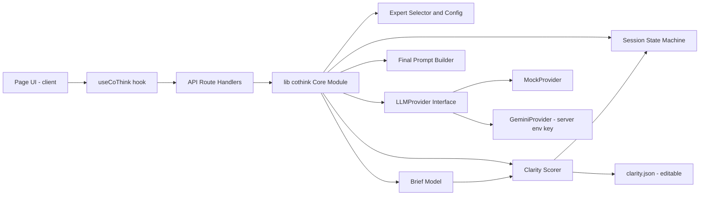

# PLAN.md: CoThink Module (Plan B: Next.js + server-side LLM route) + Clarity Score

> Read this file fully before doing anything. Work in **Planning mode first**: show me your plan, wait for approval, then execute phase by phase. Stop at every checkpoint.

## 0. Hard constraints (non-negotiable)

1. **Time box: 60 minutes of build.** Prefer a small working module over a large unfinished one. If behind schedule, cut live Gemini testing first. Never cut the Clarity Score or the acceptance checks.
2. **Greenfield only.** Create everything inside the new project folder `VELOCITY-COTHINK-Manas/`. Do not read, modify or delete anything outside it. No global config changes.
3. **No secrets in code or in the browser.** The Gemini key lives only in `.env.local` (git-ignored). Commit `.env.example` with placeholders only. Never log the key.
4. **Synthetic data only.** No real personal data in examples, tests or fixtures.
5. **No invented facts.** The final prompt may only contain information from the confirmed brief, the expert config, or clearly labelled assumptions/unknowns.
6. **Methods are instructions, not tools.** The final prompt must say things like "Use a pre-mortem approach" or "Apply the Jobs-to-be-Done lens". It must never say a tool or skill is installed, invoked or available.
7. **Module independence.** Everything under `lib/cothink/` must work with zero imports from `app/`, `components/` or `hooks/`. The UI talks only to the public API exported from `lib/cothink/index.ts` (through the route handlers).
8. **Out of scope:** system keyboard, voice, login, payments, production deployment, database, full backend. Do not add them.
9. Keep dependencies minimal: Next.js, React, TypeScript, Tailwind, and the official Google Gen AI SDK (or plain `fetch`). Add Vitest only if time remains.
10. Ask me before adding any dependency not listed here.
11. **The Clarity Score is computed by deterministic rules in code, never by the LLM.** It must be explainable line by line during a review.

## 1. Goal

Build a small, reusable **CoThink** module for a future AI keyboard. It helps a user clarify intent through a conversation with a subject-matter expert who challenges assumptions and reasoning, instead of running a fixed questionnaire. A thin Next.js demo screen sits on top.

**Signature feature: Clarity Score.** A live 0 to 100 meter that shows how specific the user's idea has become across six dimensions. It rises as the user answers, drops if a correction removes information, picks which gap the expert probes next, and decides when the interview is ready to move to the summary.

### Required behaviour (from the assignment)

- Start by asking what the user is trying to do (typed input).
- Choose an appropriate **expert perspective** and ask **one adaptive question at a time**.
- User can **correct a previous answer** or press **Generate now**.
- Show an **editable summary**: goal, context, constraints; unknowns and assumptions are labelled; user **confirms**.
- Generate a **copyable final prompt** reflecting the confirmed brief, expert role and useful methods (as instructions).
- Real LLM used safely, **or** a clearly labelled mock. Document how a real provider is integrated.

## 2. Architecture



Session state is held by the **client** and sent back on each call. The core is pure and stateless: it takes a session object and returns an updated one. This keeps the module reusable and avoids a backend. Document this in the README.

## 3. Project structure

```
VELOCITY-COTHINK-Manas/
├── PLAN.md
├── README.md
├── .env.example
├── .gitignore                  (must include .env.local)
├── app/
│   ├── layout.tsx
│   ├── page.tsx                (mobile-first demo screen)
│   └── api/cothink/
│       ├── start/route.ts
│       ├── answer/route.ts
│       ├── correct/route.ts
│       ├── generate-now/route.ts
│       ├── summary/route.ts    (update summary fields)
│       ├── confirm/route.ts
│       └── final/route.ts
├── components/
│   ├── Chat.tsx
│   ├── ClarityMeter.tsx        (score, dimension chips, "why" detail)
│   ├── SummaryEditor.tsx
│   ├── FinalPrompt.tsx
│   └── ProviderBadge.tsx       (shows "Mock" or "Gemini" clearly)
├── hooks/
│   └── useCoThink.ts
├── lib/cothink/
│   ├── index.ts                (PUBLIC API: only export from here)
│   ├── types.ts
│   ├── session.ts              (state machine)
│   ├── brief.ts                (brief model and revision handling)
│   ├── clarity.ts              (clarity scorer, pure functions)
│   ├── expertSelector.ts
│   ├── promptBuilder.ts        (final prompt assembly)
│   ├── experts/
│   │   ├── experts.json        (editable expert definitions)
│   │   ├── interviewer.md      (editable interviewing instructions)
│   │   ├── methods.json        (editable methods/skills wording)
│   │   └── clarity.json        (editable weights, thresholds, hedge words)
│   └── providers/
│       ├── provider.ts         (LLMProvider interface)
│       ├── mock.ts
│       ├── gemini.ts
│       └── index.ts            (provider factory from env)
└── tests/                      (optional, only if time remains)
```

## 4. Module contract (public API in `lib/cothink/index.ts`)

All operations are async, take a session (except start) and return `{ session, result, clarity }`. Define the exact TypeScript types in `types.ts` from this table.

| Operation | Input | Output |
|---|---|---|
| `startSession` | `{ initialIntent?: string }` | New session; `result` is the opening question ("What are you trying to do?") or, if an intent was given, the first adaptive question; `clarity` is the starting score |
| `submitAnswer` | `{ session, answer }` | Updated session; `result` is `{ type: "question", text, rationale, targetDimension }` **or** `{ type: "summary", brief }` when the stop rule is met |
| `correctAnswer` | `{ session, turnId, newAnswer }` | Updated session with that turn revised, brief re-derived and score recomputed; `result` is the next question or the refreshed summary |
| `generateNow` | `{ session }` | Skips remaining questions; `result` is `{ type: "summary", brief }` with every uncovered dimension listed under Unknowns |
| `updateSummary` | `{ session, edits }` | Session with user edits applied to the brief (user edits always win); score recomputed |
| `confirmBrief` | `{ session }` | Session in `confirmed` stage; **rejects if the brief has no goal** |
| `generateFinalPrompt` | `{ session }` | `{ prompt: string, meta: { expertRole, methods, provider, finalClarity } }`; **only valid when confirmed** |
| `getClarity` | `{ session }` | Current clarity object (also included in every result above) |

### Session stages

`intake` → `interview` → `summary` → `confirmed` → `final`

- Any edit or correction after `summary` returns the session to `summary` and clears confirmation.
- The interview ends by the **stop rule in section 6**, or at the hard cap of **6 questions** (configurable).

### Brief model

| Field | Notes |
|---|---|
| `goal` | What the user is trying to do |
| `context` | Who it is for, situation, evidence given |
| `constraints` | Budget, time, tools, rules the user stated |
| `unknowns` | Things not yet answered; each labelled `UNKNOWN` |
| `assumptions` | Anything inferred, each labelled `ASSUMPTION` and never presented as fact |
| `expert` | `{ role, rationale }` |

Every item in `context` and `constraints` must be traceable to something the user said. Store `sourceTurnId` per item so corrections can update or remove it. **Every brief item also carries a `dimension` tag** (one of the six clarity dimensions) so the scorer can read coverage straight from the brief.

## 5. Expert interviewing logic (40% of the score: spend time here)

Edit `experts/interviewer.md` and `experts/experts.json` rather than hard-coding prompts in logic files.

### Expert selection

- After the first answer, pick one expert from `experts.json` (for example: Product Strategist, Software Architect, Career Coach, Marketing Strategist, Financial Planner, Generalist Fallback).
- Return the role and a one-line reason. If unsure, use Generalist Fallback and say so.

### Question rules (put these in `interviewer.md`)

1. Ask **exactly one question** per turn, and keep it short enough to read on a phone.
2. **Reference the user's last answer** in the question (quote or paraphrase a specific detail). No generic questions.
3. **Challenge one assumption or reasoning gap per turn**: who it is for, what problem it solves, what evidence supports it, what happens if the assumption is wrong, what alternative was considered.
4. Prefer "why / what evidence / what would change your mind" over yes/no questions.
5. Never repeat a topic already answered unless the user corrected it.
6. Never invent facts about the user's situation. If the user hasn't said it, ask or mark as unknown.
7. **Aim each question at the dimension the module names as the biggest gap** (see section 6), while still tying it to the user's last answer.
8. Tone: thoughtful, direct, respectful. Not a quiz, not a lecture.

### Output format from the LLM

Ask the provider for **structured JSON** only: `{ action: "ask" | "summarize", question?, rationale?, targetDimension?, briefPatch? }`. Validate and parse safely. On malformed output, retry once, then fall back to the mock logic. Never crash the UI. The LLM may suggest which dimension an answer addressed through `briefPatch`, but **the score itself is always computed by `clarity.ts`**.

### Worked example to use as the primary test

User: "I want to build a budgeting app."
Expected: expert = Product Strategist. Starting score is low (goal only, partially covered). First question challenges **who it is for and what problem**, not "what features do you want". The next question must quote the user's reply (for example, if they say "college students", ask what evidence they have that students struggle with budgeting rather than saving, or why existing apps fail them). The score visibly rises after each substantive answer.

## 6. Clarity Score (signature feature)

### Purpose

Make the user's progress from vague to specific visible, make the expert's choice of next question explainable, and give the interview a principled end condition instead of a fixed count.

### Dimensions and default weights (editable in `experts/clarity.json`)

| Dimension | Weight | Counts as covered when |
|---|---|---|
| Goal | 20 | The brief has a goal statement the user gave |
| Audience / context | 20 | The brief has who it is for or the situation, from the user |
| Problem | 20 | The brief has the problem or need being solved |
| Evidence | 15 | The user gave a reason, example, observation or data point supporting the idea |
| Constraints | 15 | The user stated at least one limit (time, budget, tools, rules, scope) |
| Risk / assumption challenged | 10 | The user addressed what could go wrong or what they are assuming |

### Status per dimension

- **Covered**: full weight. There is at least one user-sourced brief item tagged with the dimension, and it is not hedged.
- **Partial**: half weight. The item exists but the answer is very short (below a minimum word count in `clarity.json`) or contains hedge words from the editable list ("maybe", "not sure", "I guess", "probably", "something like").
- **Missing**: zero. No user-sourced item for the dimension.

Score = sum of weights times status factor, rounded to a whole number from 0 to 100. Assumptions that the module inferred itself **never** count towards coverage.

### How the score is used

1. **Display.** Show the score, the six dimension chips with their status, and the change since the last turn (for example "+20").
2. **Next question choice.** The next question targets the **uncovered or partial dimension with the highest weight**; ties break in the order of the table above. Record it as `targetDimension` and show it in the rationale ("Probing: Evidence").
3. **Stop rule.** Move to the summary when the score reaches the threshold in `clarity.json` (default 70) **and** Goal, Audience and Problem are not Missing. Otherwise continue until the hard cap of 6 questions.
4. **Corrections.** Editing an earlier answer re-derives the brief and recomputes the score. The score may go down, and the meter should show the drop. This is how a correction is visibly reflected.
5. **Generate now.** Show the current score and turn every Missing or Partial dimension into a labelled `UNKNOWN` in the summary.
6. **Final prompt.** Do not put the number inside the prompt as if it were a fact about the user's project. It appears only in `meta.finalClarity` and in the UI.

### Rules for the scorer in code

- `clarity.ts` exports pure functions: compute the score from a brief, list the gaps, and choose the target dimension. No network calls and no provider imports.
- All weights, the threshold, the minimum word count and the hedge word list come from `experts/clarity.json`, so they can be edited without touching code.
- Each result includes a short plain-language reason per dimension (for example "Evidence: missing, no reason or example given yet") for the meter's "why" detail.

## 7. Providers

### Interface

`LLMProvider` exposes one method that takes a system instruction, the conversation turns, the current brief and the current clarity gaps, and returns the structured response above. It also exposes `name` and `isMock`.

### MockProvider (default)

- Clearly labelled in the UI badge and in the README: **"Mock: deterministic, no real LLM"**.
- Must still be **adaptive**: extract keywords/entities from the last answer, insert them into the next question template, and pick the template from the **target dimension** the scorer supplies.
- Handle at least these domains well: app/product idea, writing task, career/job question. Anything else uses a generic but still answer-referencing template.
- Tag the answer it just received with the dimension its previous question targeted, so the score moves.

### GeminiProvider

- Runs **server-side only**, called from route handlers.
- Reads `GEMINI_API_KEY` and `GEMINI_MODEL` from env. If the key is missing, the factory silently falls back to the mock and the badge shows "Mock".
- Request timeout and one retry. Show a friendly error in the UI if it fails, with a button to continue in mock mode.
- Do not send anything except the conversation, the gaps and the interviewer instructions.

### Env (`.env.example`)

```
COTHINK_PROVIDER=mock        # mock | gemini
GEMINI_API_KEY=              # leave empty in the repo
GEMINI_MODEL=                # set to a current Flash model name
```

## 8. Final prompt builder

Assemble the prompt from fixed sections so it is predictable and easy to check:

1. **Role**: "You are a [expert role] ..." taken from the confirmed expert.
2. **Goal**: from the confirmed brief.
3. **Context**: user-stated items only.
4. **Constraints**: user-stated items only.
5. **Assumptions and unknowns**: listed explicitly and labelled; tell the model to flag them, not treat them as facts.
6. **Method instructions**: 2 to 4 methods from `methods.json` worded as instructions (for example "Start by restating the goal; then challenge the riskiest assumption; propose options with trade-offs"). **Never imply any tool or skill is installed or invoked.**
7. **Output expectations**: format and tone, derived from the goal.
8. **Honesty rule**: "Do not invent facts. If information is missing, ask or state your assumption."

The builder is **deterministic from the confirmed brief** (no extra LLM call), which makes it faithful by construction. Mention an optional LLM-polish step in the README as a future improvement, not in the build.

## 9. Demo UI (mobile-first, keep it plain)

- Single page, max width ~420px centred on desktop, full width on mobile.
- Stage 1: text box "What are you trying to do?"
- Stage 2: chat thread; each user answer has an **Edit** button (calls `correctAnswer`); a persistent **Generate now** button.
- **Clarity meter pinned at the top during the interview**: score, a bar, six dimension chips (covered / partial / missing), the "+N" change after each answer, and a small "Probing: [dimension]" label next to each expert question. Tapping the meter shows the per-dimension reasons.
- Stage 3: summary editor with labelled sections; unknown and assumption items visibly tagged; the final score and any remaining gaps; **Confirm** button (disabled until a goal exists).
- Stage 4: final prompt in a read-only box with **Copy** button and the expert/method metadata.
- Always show the provider badge (Mock or Gemini).
- Loading and error states for every call. No extra pages, no auth.

## 10. Time-boxed phases and Antigravity prompts

Pause for my approval at the end of each phase.

| Phase | Min | Deliverable |
|---|---|---|
| 1 | 0-7 | Scaffold Next.js + TS + Tailwind; create the folder tree exactly as in section 3 with empty or stub files; `.gitignore` and `.env.example` |
| 2 | 7-20 | `types.ts`, `session.ts`, `brief.ts` (with dimension tags), provider interface, **MockProvider**, `index.ts` public API |
| 3 | 20-28 | `experts.json`, `interviewer.md`, `methods.json`, `expertSelector.ts`, `promptBuilder.ts` |
| 4 | 28-36 | **Clarity Score**: `clarity.ts`, `clarity.json`, stop rule and target-dimension logic wired into the session and mock |
| 5 | 36-42 | Route handlers and `GeminiProvider`, provider factory with mock fallback |
| 6 | 42-52 | UI components (including `ClarityMeter`) and `useCoThink` hook, wired to the routes only |
| 7 | 52-60 | Manual acceptance run (section 11), fix gaps, write README |

Suggested prompt per phase (paste one at a time):

1. "Follow PLAN.md section 3. Scaffold the project and create the folder structure with stub files only. Do not implement logic yet."
2. "Implement PLAN.md sections 4 and 7 (Mock only): types, the stateless session state machine, brief model with per-item sourceTurnId and dimension tag, MockProvider and the public API. No imports from outside lib/cothink."
3. "Implement PLAN.md sections 5 and 8: editable expert config files, expert selector, and the deterministic final prompt builder."
4. "Implement PLAN.md section 6: pure clarity scorer, editable clarity.json, target-dimension selection, stop rule, and wire the score into every operation's output. The score must be rule-based, with no LLM involvement."
5. "Implement the route handlers and GeminiProvider per PLAN.md section 7. Server-side only, key from env, fallback to mock, validate JSON output."
6. "Build the UI per PLAN.md section 9 using only the hook and routes. Include the clarity meter, the Probing label and the provider badge."
7. "Run the acceptance checklist in PLAN.md section 11 and report pass/fail with evidence. Then draft the README per section 12."

## 11. Acceptance checklist (must all pass; capture for the demo video)

**Assignment criteria**

- [ ] Vague input ("I want to build a budgeting app") gets one useful question that challenges assumptions.
- [ ] The next question visibly reflects the user's previous answer.
- [ ] Correcting an earlier answer changes the brief (and removes or updates dependent items).
- [ ] Generate now works at any point and lists gaps under Unknowns.
- [ ] Summary is editable, unknowns and assumptions are labelled, and Confirm is required.
- [ ] Editing after confirmation returns to the summary stage.
- [ ] Final prompt contains only confirmed brief content, the expert role and method instructions, with no claims of installed tools.
- [ ] `lib/cothink` has no imports from `app/`, `components/` or `hooks/` (verify with a grep).
- [ ] No secrets in the repo (grep for the key pattern; `.env.local` is ignored).
- [ ] Works in mock mode with no env configured; Gemini mode works when the key is set (if time allows).

**Clarity Score criteria**

- [ ] The starting score for a vague one-line idea is low, and rises after a substantive answer.
- [ ] A hedged or very short answer counts as Partial, not Covered.
- [ ] The "Probing: [dimension]" label matches the highest-weight uncovered or partial dimension.
- [ ] Correcting an earlier answer so it no longer contains the information lowers the score and the meter shows the drop.
- [ ] The interview moves to the summary when the threshold is met with Goal, Audience and Problem covered, or at the 6-question cap.
- [ ] Generate now at a low score turns each Missing or Partial dimension into a labelled UNKNOWN.
- [ ] Changing weights or the threshold in `clarity.json` changes behaviour without any code change.
- [ ] The score is identical for the same brief in mock and Gemini mode (it never depends on the LLM).

## 12. README must include

- Setup and run instructions
- Module interface (the table in section 4) with inputs and outputs
- **Clarity Score**: dimensions, weights, status rules, how it drives the next question and the stop rule, and how to tune `clarity.json`
- Integration steps for another host app (copy `lib/cothink`, implement or choose a provider, call the operations)
- Mock vs provider configuration and how to add another provider (for example OpenAI or Claude) by implementing `LLMProvider`
- How to edit the expert instructions (`experts/` folder)
- Limitations and honest tradeoffs (mock is keyword-based, stateless client-held session, no persistence, JSON-validation fallback, the score measures coverage and specificity of what was said, not the quality or truth of the idea)
- Time spent (actual) and AI tools used (Antigravity and any model used)
- Link to the 2-3 minute demo video

## 13. Demo video outline (2-3 min)

1. 0:00-0:20: What CoThink is and the module/UI split (show folder tree).
2. 0:20-1:30: Live run: vague idea with a low clarity score, adaptive question with the Probing label, answer, score rises, follow-up that quotes the answer, correct an answer and show the score drop.
3. 1:30-2:15: Editable summary with labelled unknowns/assumptions, confirm, final prompt, copy.
4. 2:15-3:00: Code walkthrough: `index.ts` public API, `clarity.ts` with `clarity.json`, `interviewer.md`, `provider.ts`, and the mock/Gemini switch.

## 14. Submission

- Repo or ZIP named `VELOCITY-COTHINK-Manas`
- Email to career@toteminteractive.in and totemistaken@gmail.com
- Subject: `VELOCITY-COTHINK-Manas`
- Deadline: 72 hours from receiving the brief. Keep actual development effort within the time limit.
