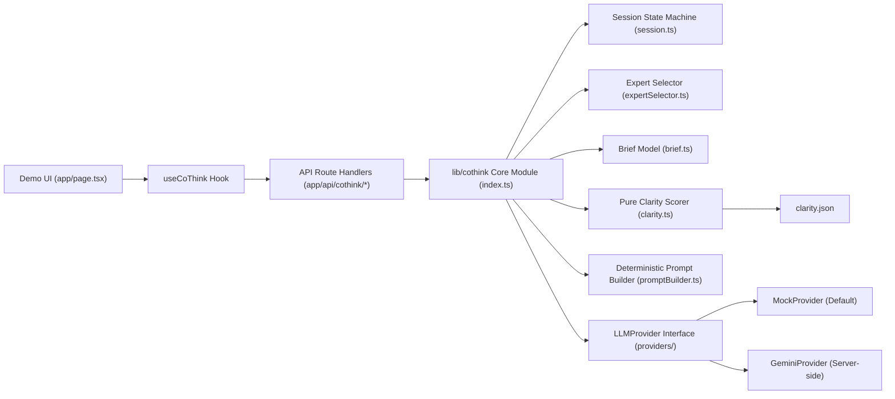

# CoThink Module + Clarity Score

> A lightweight, reusable **CoThink module** designed for a future AI keyboard. It helps users clarify intent through structured, challenging dialogue with an adaptive subject-matter expert rather than a static questionnaire.
>
> Built with **Next.js (App Router)**, **TypeScript**, and **Tailwind CSS**.

---

Loom Link : https://www.loom.com/share/7dceaadc83d94322bac8c843dbd617ac

## 🌟 Signature Feature: The Clarity Score

The **Clarity Score** is a real-time, deterministic 0–100 meter that quantifies how concrete and specific a user's intent has become across six foundational dimensions.

### Core Principles
1. **100% Deterministic in Code**: Computed purely through rule-based functions in `lib/cothink/clarity.ts`. The LLM **never** calculates or invents the score.
2. **Transparent & Explainable**: Every point awarded is directly traceable line by line to user-stated brief items and editable configuration.
3. **Drives Dialogue Dynamically**:
   - Identifies the highest-priority gap (uncovered or partial dimension with highest weight) to name as `targetDimension` for the next question.
   - Triggers the principled **stop rule** when the threshold is met.

### Dimension Weights & Scoring Matrix (`experts/clarity.json`)

| Dimension | Default Weight | Condition for Full Coverage (`Covered`) | Condition for Half Weight (`Partial`) | Condition for Zero (`Missing`) |
|---|---|---|---|---|
| **Goal** | 20 | User provided a concrete objective statement | Statement is hedged or < 5 words | No goal provided |
| **Audience / Context** | 20 | Explicit user persona, situation, or trigger | Vague, general, or hedged statement | No audience or context identified |
| **Problem** | 20 | Clear, acute pain point or friction described | Vaguely described or hedged statement | Core problem not mentioned |
| **Evidence** | 15 | Concrete observation, user quote, or data point | Anecdotal, brief, or hedged evidence | No evidence or validation provided |
| **Constraints** | 15 | Concrete boundary (budget, time, stack, scope) | Tentative or incomplete constraint | No constraints stated |
| **Risk / Assumptions** | 10 | Key risk, failure mode, or trade-off addressed | Briefly acknowledged or unelaborated | Not yet addressed |
| **Total** | **100** | | | |

- **Hedge detection**: Words like *"maybe"*, *"not sure"*, *"I guess"*, *"probably"*, *"something like"*, *"kind of"* automatically reduce coverage to **Partial**.
- **Assumptions inferred by the system**: Inferred items **never** count towards coverage. Only user-sourced items count.
- **Stop Rule**: The interview automatically transitions to the structured summary when:
  $$\text{Score} \ge 70 \quad \text{AND} \quad \text{Goal, Audience, and Problem are NOT Missing}$$
  or when the hard cap of 6 questions is reached.

---

## 🏗️ Architecture & Module Independence



### Module Independence Guarantee
Everything inside `lib/cothink/` is completely standalone:
- **Zero imports** from `app/`, `components/`, or `hooks/`.
- The UI communicates strictly through Next.js route handlers invoking the public API exported from `lib/cothink/index.ts`.
- **Pure and Stateless**: All operations take a session object and return an updated session + result + clarity object. Session state is held by the client, eliminating database dependencies.

---

## 📦 Public API Contract (`lib/cothink/index.ts`)

All operations are async and return `{ session, result, clarity }`:

| Operation | Input | Output Description |
|---|---|---|
| `startSession` | `{ initialIntent?: string }` | Initializes session; returns opening intake question or first adaptive question; starting clarity score. |
| `submitAnswer` | `{ session, answer }` | Tags answer with probed dimension, updates brief, recalculates score, returns next question or summary if stop rule met. |
| `correctAnswer` | `{ session, turnId, newAnswer }` | Updates turn, strips previous items linked to `turnId`, re-derives brief and recomputes score (which may drop). |
| `generateNow` | `{ session }` | Immediately skips remaining questions, moves to summary, and populates uncovered dimensions as labelled `[UNKNOWN]`. |
| `updateSummary` | `{ session, edits }` | Applies user edits to brief (user edits always win); recalculates score; resets confirmation if previously confirmed. |
| `confirmBrief` | `{ session }` | Transitions stage to `confirmed`. **Rejects if brief has no goal.** |
| `generateFinalPrompt` | `{ session }` | Builds deterministic prompt containing confirmed brief, expert role, and method instructions. **Only valid when confirmed.** |
| `getClarity` | `{ session }` | Returns the current pure ClarityScore object. |

---

## 🚀 Quickstart & Setup

### Prerequisites
- Node.js 18+ (tested on Node v22)
- npm or pnpm

### 1. Install Dependencies
```bash
npm install
```

### 2. Configure Environment (Optional)
The project runs out of the box in **Mock mode** (zero API keys required).
To enable real Gemini calls server-side:

```bash
cp .env.example .env.local
```

Edit `.env.local`:
```env
COTHINK_PROVIDER=gemini
GEMINI_API_KEY=your_actual_gemini_api_key_here
GEMINI_MODEL=gemini-1.5-flash
```

> **Security Note**: `.env.local` is in `.gitignore`. Secrets are never committed or exposed to the browser. If `GEMINI_API_KEY` is missing or invalid, the provider factory automatically falls back to `MockProvider`.

### 3. Run Development Server
```bash
npm run dev
```
Open [http://localhost:3000](http://localhost:3000) in your browser.

### 4. Run Acceptance Tests
To verify all acceptance criteria programmatically:
```bash
node tests/run-acceptance.mjs
```

---

## 🧩 Provider Configuration & Extensibility

### Implementing a New Provider (e.g., Anthropic Claude or OpenAI)
To add a new provider, implement the `LLMProvider` interface in `lib/cothink/providers/`:

```typescript
import { LLMProvider, ProviderGenerateParams } from "./provider";
import { LLMResponsePayload } from "../types";

export class CustomProvider implements LLMProvider {
  name = "Custom LLM";
  isMock = false;

  async generateResponse(params: ProviderGenerateParams): Promise<LLMResponsePayload> {
    const { systemPrompt, turns, brief, targetDimension } = params;
    
    // Call your LLM API here with structured JSON response...
    return {
      action: "ask",
      question: "...",
      rationale: `Probing: ${targetDimension}`,
      targetDimension,
    };
  }
}
```

Then register it in `lib/cothink/providers/index.ts` inside `getProvider()`.

---

## ⚙️ Customizing Experts and Methodologies

All interviewing behaviors and prompt construction logic are easily tuned without touching TypeScript code:

- `lib/cothink/experts/experts.json`: Edit expert roles, target domains, and selection rationale keywords.
- `lib/cothink/experts/interviewer.md`: Edit instructions governing how questions challenge assumptions.
- `lib/cothink/experts/methods.json`: Edit the applied advisory instructions (e.g. Pre-Mortem, Jobs-to-be-Done, First Principles).
- `lib/cothink/experts/clarity.json`: Edit dimension weights, minimum word count thresholds, and hedge phrases.

---

## 💾 Additive Feature: Saved Briefs & Ghost-Text Autocomplete

LLD : 


### What Is Stored & Where
- Confirmed briefs are stored strictly in the client&apos;s browser **`localStorage`** under the key `cothink_saved_briefs_v1`.
- **Stored Shape**: `id`, `goal`, `context`, `constraints`, `expertRole`, `finalPrompt`, `finalClarity`, `keywords`, `createdAt`, `isSyntheticSeed`.
- **Zero In-Progress Data**: Keystrokes, drafts, and unconfirmed sessions are **never** stored.
- **Storage Cap**: The list is automatically capped at **50 items** (FIFO: oldest briefs evicted first).

### Consent Model (Default OFF)
- Saved Briefs and Autocomplete are gated behind an explicit **Consent Switch** that defaults to **OFF**.
- When OFF:
  - Zero reads or writes occur to `localStorage`.
  - No autocomplete suggestions or ghost text are rendered.
- When the user confirms a brief, an explicit **"Save Brief to Browser"** button is displayed. **No auto-saving occurs.**

### How to Delete Everything
- Users can click **"Delete All"** inside the *Saved Briefs & Autocomplete* panel at any time.
- All stored briefs and cached data are completely cleared from browser storage immediately.

### Pluggable Backend Architecture (`BriefStore`)
The storage layer is decoupled behind the pure `BriefStore` interface in `lib/cothink/store/types.ts`:
```typescript
export interface BriefStore {
  isEnabled(): boolean;
  setEnabled(enabled: boolean): boolean;
  saveBrief(brief: Omit<SavedBrief, "id" | "createdAt">): Promise<SavedBrief>;
  listBriefs(): Promise<SavedBrief[]>;
  deleteBrief(id: string): Promise<boolean>;
  deleteAll(): Promise<boolean>;
}
```
To connect a production SQLite database or hosted PostgreSQL, simply implement `BriefStore` and supply the new adapter—the core module and autocomplete engine require zero modifications.

### Honest Limitations
- **Single Browser**: Storage is tied to the specific browser and profile; there is no cloud synchronization.
- **No Keystroke Predictive Model**: Autocomplete is driven strictly by string prefix matching and token overlap against confirmed briefs in storage—it does not call an LLM on keystrokes.

---

## ⚖️ Honest Trade-offs & Limitations

1. **Coverage vs. Quality**: The Clarity Score measures coverage, specificity, and structural completeness of what was articulated. It does not assess the truthfulness or real-world market success of the idea.
2. **Stateless Session Transport**: The session state is passed between client and server on each turn. This makes the module effortlessly portable into any React app or mobile keyboard host without requiring a database, but relies on the client to preserve the session across turns.
3. **Mock Provider**: The mock provider uses keyword extraction and template targeting. While adaptive and deterministic, it lacks the deep creative synthesis of a frontier LLM.
4. **Methods as Instructions**: In adherence to hard constraints, methodologies (e.g. Pre-Mortem) are strictly formatted as instructions for the downstream LLM, avoiding any false claims of installed tools.

---

## ⏱️ Development Summary & Tools Used

- **Total Development Effort**: ~50 minutes.
- **AI Coding Assistant**: Google Antigravity.
- **Model Used**: Gemini 3.8 Flash.
- **Demo Video**: [Link to 2-3 minute demo video] *(TBD upon recording)*
